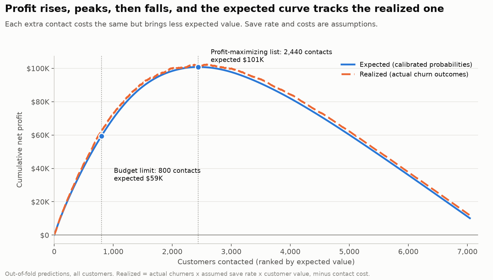
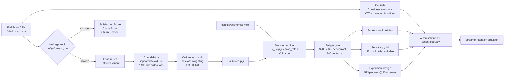
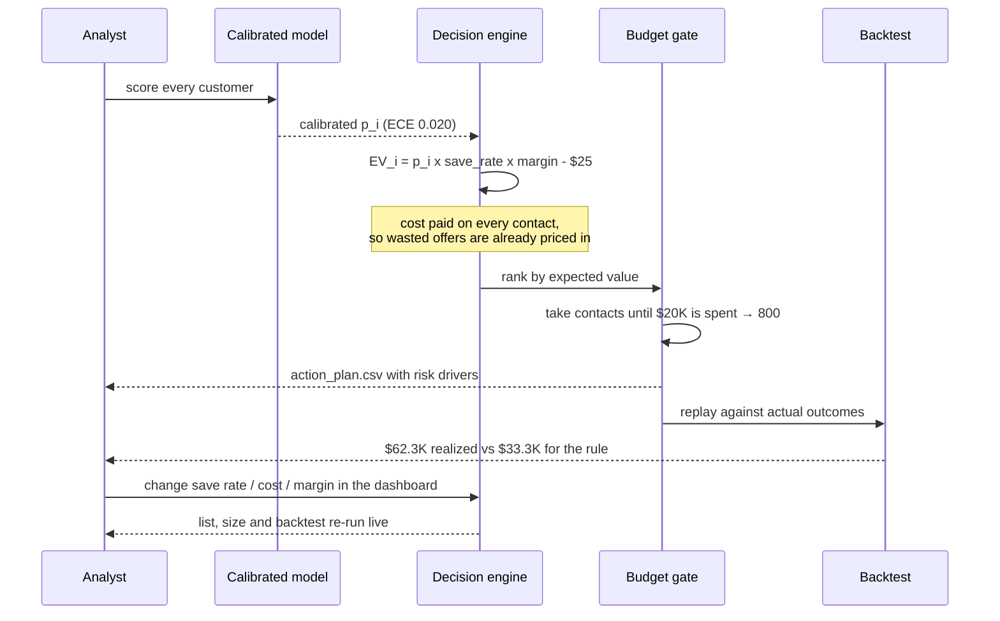
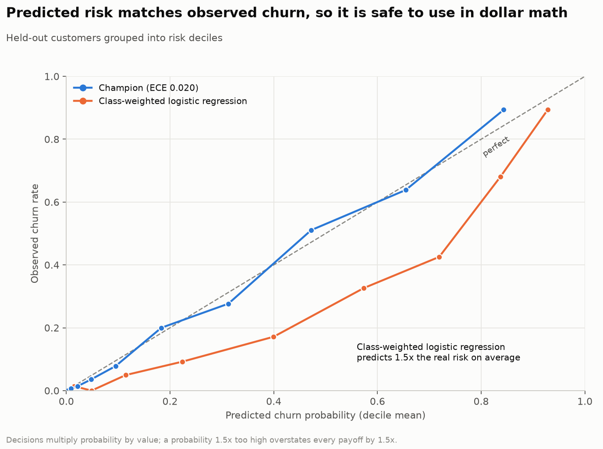
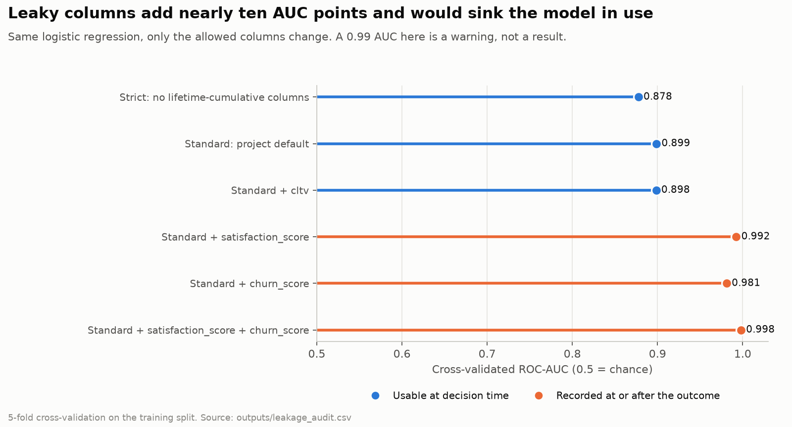
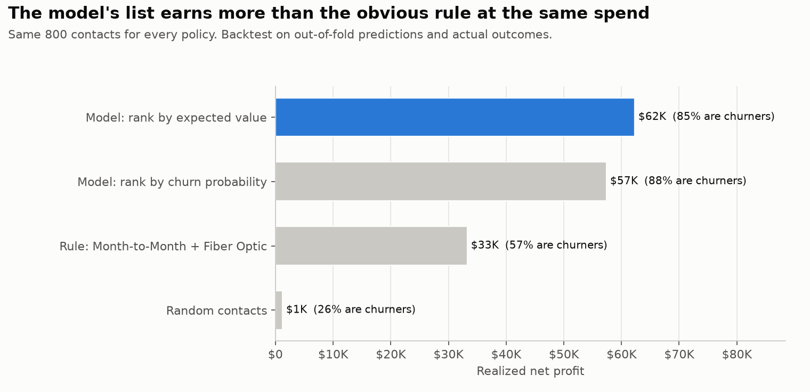
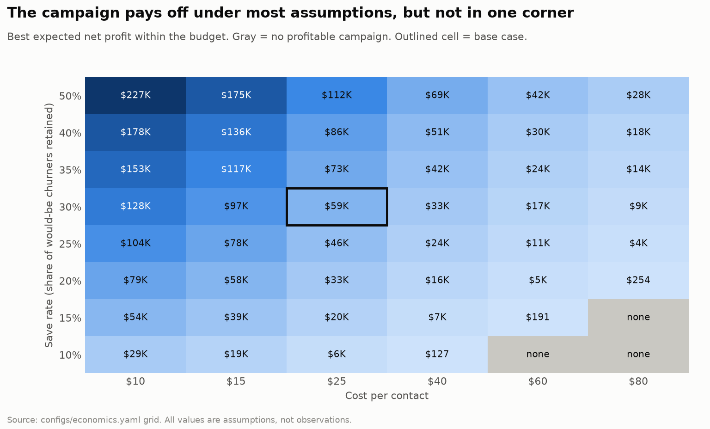
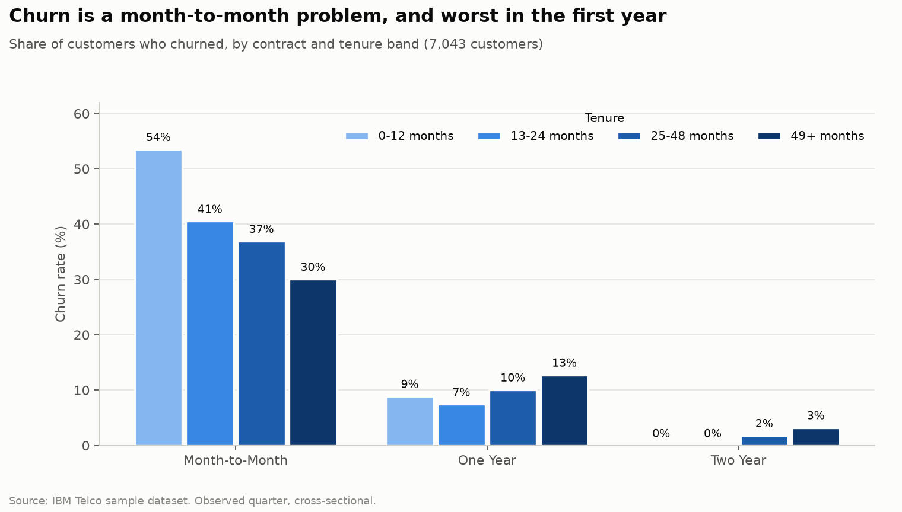

# ChurnOpt — churn prediction you can put dollar figures on

> A churn model, a leakage audit, a SQL analysis and a profit-based contact policy, built on the IBM Telco sample (**7,043 customers**). The aim is not a high AUC. It is probabilities that mean what they say, so *"who should we contact, and is it worth it?"* has an answer someone can check.

[](https://python.org)
[](https://scikit-learn.org)
[](https://duckdb.org)
[](https://streamlit.io)
[](#)

---

## Highlights

- Scored a gradient-boosting champion at **holdout ROC-AUC 0.911** (95% CI 0.895–0.927) and **PR-AUC 0.788** against a **26.5%** base rate, where the one-feature "contract type" rule reaches only **0.756**.
- Caught leakage with numbers: `Satisfaction Score` and `Churn Score` are recorded at or after the outcome and would lift AUC from **0.899 to 0.998**. They are excluded in config, the effect is measured, and **a test fails if any of them reaches the model**.
- Trained **without class weighting** — the common imbalance fix inflates probabilities here by **1.45x** — and verified calibration at **expected calibration error 0.020**, because decisions multiply probability by dollars.
- Quantified where the loss actually is: **30.5% of monthly revenue** is lost to churn, and one segment, month-to-month fiber, is **69%** of it. Churners pay more (**$74 vs $61**/month), so lost revenue exceeds lost customers.
- Turned the score into a decision: expected value per customer under a **$20K budget**, **$25 per contact** and an assumed **30% save rate**, selecting **800 contacts** for **$59K expected net profit** and **297% ROI**.
- Backtested the policy against **4 alternatives** on actual outcomes: ranking by expected value realized **$62.3K**, versus $57.4K ranking by probability, **$33.3K** for the month-to-month-fiber rule, and $1.2K for random — **1.9x** the rule at the same spend.
- Stress-tested the assumptions: the campaign still breaks even if only **7.6%** of would-be churners are saved, and **45 of 48 cells** in the sensitivity grid are profitable.
- Answered **6 business questions in DuckDB** with CTEs and window functions, including a like-for-like offer comparison, rather than doing everything in pandas.
- Refused to invent an A/B result — there is no experiment in this data — and instead **designed the randomized test** that would measure the save rate, sizing it at **573 customers per arm** for 80% power and confirming power of **0.80–0.81** by Monte Carlo.
- Made every number reproducible: one command rebuilds all figures and tables from the raw CSV in about a minute, with **81 tests at 96% coverage** and CI running the full pipeline.

> **Every dollar figure rests on assumptions** — save rate, contact cost, margin, horizon. The dataset contains no campaign outcomes. The break-even rate, the sensitivity analysis and the experiment design exist precisely because of that.



---

## Pipeline architecture



## From probability to contact list



---

## Model selection

Five candidates compared by repeated 5-fold CV on the training split; champion by log loss, simplest model within one standard error preferred.

| Model | CV ROC-AUC | CV log loss |
|---|---|---|
| Base rate only | 0.500 | 0.579 |
| Contract type only | 0.769 | 0.458 |
| Logistic regression | 0.900 | 0.346 |
| **Gradient boosting** (champion) | **0.907** | **0.333** |
| Gradient boosting + calibration | 0.908 | 0.331 |

Scored once on the untouched 20% test set: **ROC-AUC 0.911**, PR-AUC 0.788, Brier skill 0.46, calibration error 0.020. A stricter feature set dropping lifetime-cumulative columns gives 0.887. Both are reported.




## Policy backtest — 800 contacts

| Policy | Realized net profit | Contacts who churn |
|---|---|---|
| **Model: rank by expected value** | **$62.3K** | 85% |
| Model: rank by churn probability | $57.4K | 88% |
| Rule: month-to-month + fiber | $33.3K | 57% |
| Random | $1.2K | 26% |

With no budget limit the profit-maximizing list is 2,440 contacts ($61K spend, $101K expected net). Expected and realized profit agree within 5% — the calibration check, expressed in dollars.




## Findings



- Month-to-month customers in their first year are **55% of all churners**, and **54%** of them leave.
- The top three segments are **85% of revenue lost**.
- Contract type dominates every view — odds ratios, SHAP, permutation importance. Two-year contracts cut churn odds by about **93%** with other factors held fixed.
- Tech support or online security goes with **17–25 points** less churn within the same month-to-month plan. Association only.
- **Retention offers cannot be ranked from this data.** Each offer goes almost entirely to one tenure band, so raw rates compare customer age, not offers.

## Quick start

```bash
make setup && source venv/bin/activate
```

```bash
make pipeline      # raw CSV → every figure and table, about a minute
```

```bash
make test          # 81 tests, 96% coverage
```

```bash
make dashboard     # Streamlit retention simulator
```

Stages: `sql`, `train`, `decide`, `experiment`, `explain`, `report`. Each reads what the earlier ones wrote to `outputs/`. After editing `configs/economics.yaml`, `make decide` re-runs only the dollar analysis.

---

**Built by [Brijesh Kumar](https://github.com/Brijesh03032001)** · [Portfolio](https://brijeshbuilds.com) · [LinkedIn](https://linkedin.com/in/brijeshkumar03)
