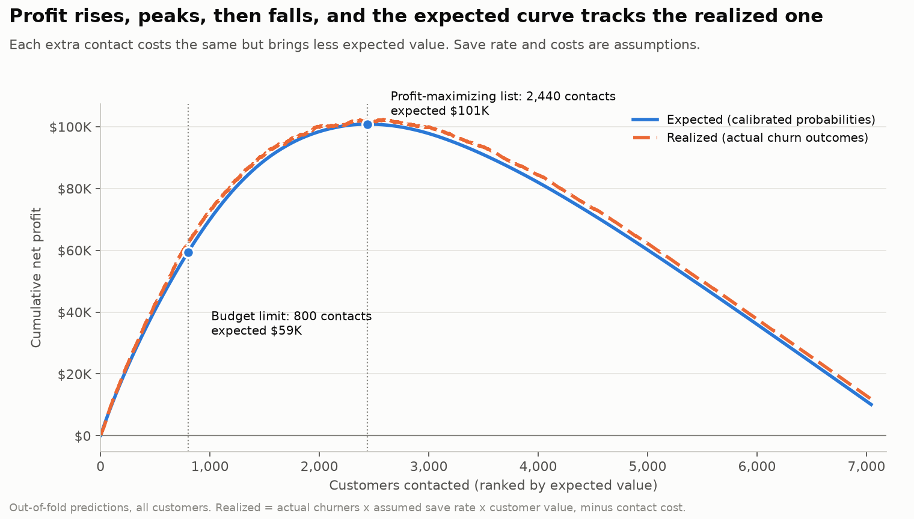
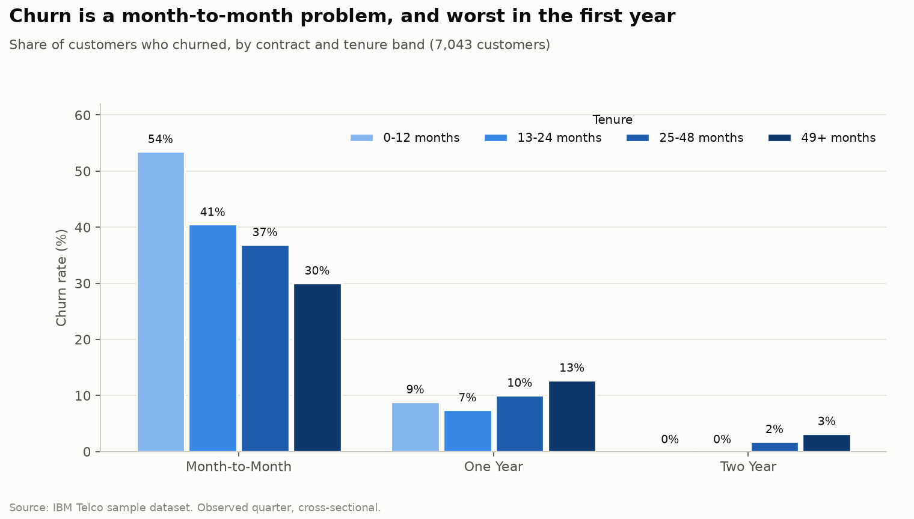
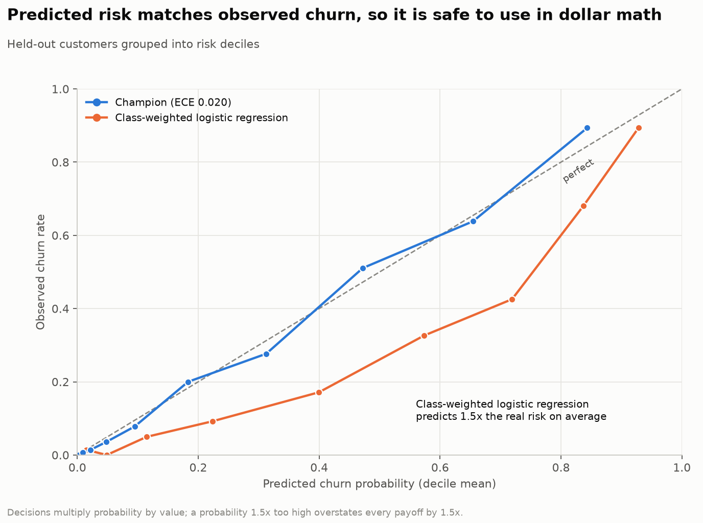
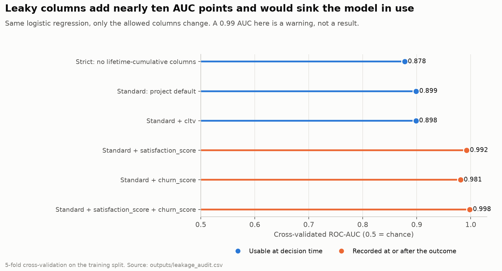
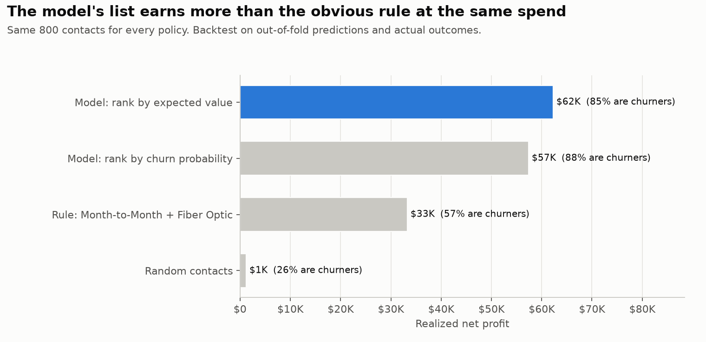
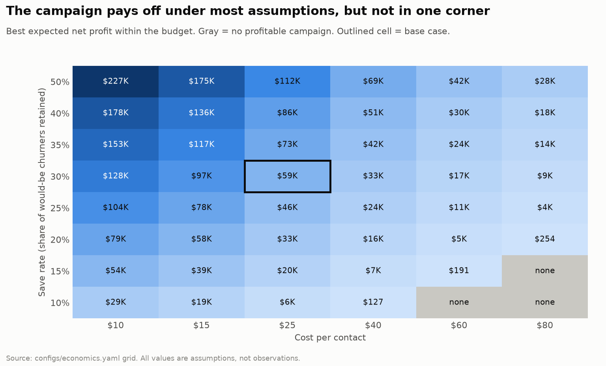

# ChurnOpt: churn prediction you can put dollar figures on

A churn model, a leakage audit, a SQL analysis, and a profit-based contact policy, built on the IBM Telco customer churn sample dataset (7,043 customers). The aim is not a high AUC. It is a set of probabilities that mean what they say, so that "who should we contact, and is it worth it?" has an answer someone can check.

## Results at a glance

| | |
|---|---|
| **Model quality** | Holdout ROC-AUC **0.911** (95% CI 0.895 to 0.927), PR-AUC 0.788 against a 26.5% base rate. The one-feature "contract type" rule scores 0.756 |
| **Calibration** | Expected calibration error **0.020**. Predicted risk matches observed churn, so it is safe to multiply by dollars |
| **Leakage caught** | `Satisfaction Score` and `Churn Score` are recorded at or after the outcome and would lift AUC from 0.899 to **0.998**. They are excluded and the effect is measured |
| **Where the loss is** | **30.5%** of monthly revenue is lost to churn. One segment, month-to-month fiber, is **69%** of it |
| **Campaign** (assumed 30% save rate, \$25 per contact, \$20K budget) | 800 contacts, expected net profit **\$59K**, ROI (net / cost) 297%. Backtested on actual outcomes: \$62K, **1.9x** the month-to-month-fiber rule at the same spend |
| **How fragile is that?** | The campaign still breaks even if only **7.6%** of would-be churners are saved. 45 of 48 cells in the sensitivity grid are profitable |

> **Every dollar figure rests on assumptions** (save rate, contact cost, margin, horizon). The dataset contains no campaign outcomes. The break-even rate, the sensitivity analysis and the experiment design exist because of that.



## What makes this different from a typical churn notebook

1. **A leakage audit with numbers.** The dataset ships columns that are really outcomes (a satisfaction survey, another model's churn score, the churn reason). Each exclusion is documented in [configs/project.yaml](configs/project.yaml) and a test fails if any of them reaches the model.
2. **Calibration before dollars.** Class weighting, the common fix for imbalance, inflates probabilities (here by 1.45x). Decisions multiply probability by value, so the model is trained without it and checked with a reliability curve.
3. **A decision, not a score.** Expected value per customer, a budget-limited contact list, a backtest against four policies, a break-even save rate, and sensitivity analysis. ROI is net over cost.
4. **Uncertainty everywhere.** Repeated cross-validation, bootstrap intervals on the holdout and on profit, a one-standard-error rule for model choice.
5. **SQL, not just pandas.** Six business questions answered in DuckDB with CTEs and window functions, including a like-for-like offer comparison.
6. **No invented evidence.** There is no A/B result here because there is no experiment. The project designs the randomized test that would measure the save rate, and validates the sample sizes by simulation.
7. **Reproducible and tested.** One command rebuilds every number and figure from the raw CSV in about a minute. 81 tests, 96% coverage, CI runs the full pipeline.

## Findings



- **Month-to-month customers in their first year are 55% of all churners**, and 54% of them leave.
- **Churners pay more** (\$74 against \$61 a month), so lost revenue (30.5%) is larger than lost customers (26.5%).
- **The top three segments are 85% of the revenue lost** ([outputs/figures/02_revenue_pareto.png](outputs/figures/02_revenue_pareto.png)).
- **Contract type dominates** in every view: odds ratios, SHAP and permutation importance. Two-year contracts cut the odds of churn by about 93% with other factors held fixed.
- **Tech support or online security** goes with 17 to 25 points less churn within the same plan on month-to-month contracts. Association only.
- **The retention offers cannot be ranked from this data.** Each offer goes almost entirely to one tenure band, so raw rates compare customer age, not offers. Offer E looks like 53% churn; against no-offer customers in the same tenure band it is still 8 points worse, but nobody randomized who got what.

## Model

Five candidates, from a base-rate predictor to gradient boosting, compared by repeated 5-fold cross-validation on the training split. Champion by log loss, with the simplest model within one standard error preferred.

| Model | CV ROC-AUC | CV log loss |
|---|---|---|
| Base rate only | 0.500 | 0.579 |
| Contract type only | 0.769 | 0.458 |
| Logistic regression | 0.900 | 0.346 |
| **Gradient boosting** (champion) | **0.907** | **0.333** |
| Gradient boosting + calibration | 0.908 | 0.331 |

Scored once on the untouched 20% test set: ROC-AUC 0.911, PR-AUC 0.788, Brier skill 0.46, calibration error 0.020. A stricter feature set that drops lifetime-cumulative columns (billing totals, referral count) gives 0.887. Both are reported.





## Decision analysis

Expected value of contacting customer *i*:

```
EV_i = p_i x save_rate x V_i - cost_per_contact
```

`p_i` is the calibrated churn probability, `V_i` the margin kept if the customer is saved, and the cost is paid for every contact (so offers wasted on customers who would have stayed are already priced in). Assumptions live in [configs/economics.yaml](configs/economics.yaml).

| Policy, 800 contacts | Realized net profit | Contacts who churn |
|---|---|---|
| Model: rank by expected value | **\$62.3K** | 85% |
| Model: rank by churn probability | \$57.4K | 88% |
| Rule: month-to-month + fiber | \$33.3K | 57% |
| Random | \$1.2K | 26% |





With no budget limit the profit-maximizing list is 2,440 contacts (\$61K spend, \$101K expected net). Expected and realized profit agree to within 5%, which is the calibration check expressed in dollars.

## Measuring what the model cannot

The model ranks by churn risk, not by who an offer would persuade, and the save rate is assumed. [src/experiments/design.py](src/experiments/design.py) sizes the randomized holdout that would measure it:

- Among the contacted customers about 85% would churn without an offer.
- Detecting the break-even save rate (7.6%) with 80% power takes **573 customers per arm**.
- The 800-contact budget list, split 50/50, can only detect a save rate of 9% or more.
- A Monte Carlo check of each design row gives simulated power of 0.80 to 0.81, matching the target.

## Dashboard

```bash
make dashboard      # or: streamlit run app/dashboard.py
```

A retention simulator over the out-of-fold predictions. Sliders for save rate, contact cost, margin, horizon and budget re-rank the customers, re-size the campaign, and re-run the backtest live. Tabs for the campaign, segment explorer, downloadable contact list with risk drivers and a customer lookup, and model quality.

## Quick start

```bash
make setup            # virtual environment + dependencies
source venv/bin/activate
make pipeline         # raw CSV to every figure and table, about a minute
make test             # 81 tests
make dashboard
```

Without `make`:

```bash
python3 -m venv venv && source venv/bin/activate
pip install -r requirements.txt
python run_pipeline.py                  # all stages
python run_pipeline.py --stage decide   # one stage
```

Stages: `sql`, `train`, `decide`, `experiment`, `explain`, `report`. Each reads what the earlier ones wrote to `outputs/`. After editing [configs/economics.yaml](configs/economics.yaml), `make decide` re-runs only the dollar analysis.

## Repository
